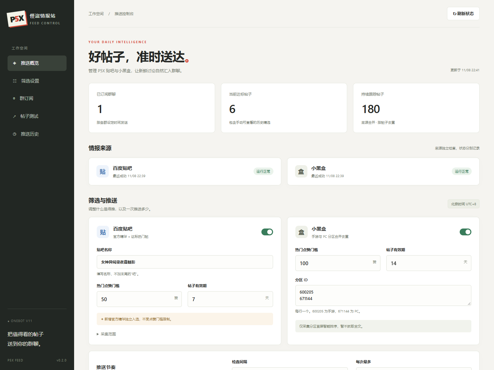
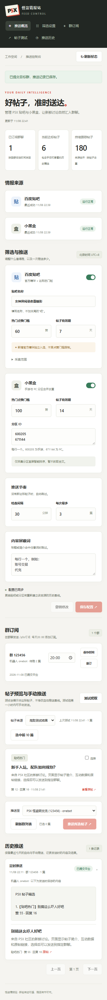

<div align="center">

# 怪盗情报站 · P5X 帖子推送

**AstrBot 插件 · 贴吧精华与热门帖 · 小黑盒热门帖 · 定时群推送**

[](https://github.com/Yamabuki-Kirio/astrbot_plugin_p5x_feed/actions/workflows/tests.yml)
[](CHANGELOG.md)
[](https://github.com/AstrBotDevs/AstrBot)
[](#环境要求)
[](LICENSE)

[安装使用](#安装) · [群聊指令](#群聊指令) · [消息排版](#消息排版与节点选择) · [配置说明](#配置说明) · [常见问题](#常见问题) · [更新日志](CHANGELOG.md)

</div>

面向《女神异闻录：夜幕魅影》的社区帖子推送插件。定期收集贴吧精华、达到点赞门槛的热门帖与小黑盒分区讨论，按各群订阅时间发送。

内置 WebUI，可配置筛选条件、测试爬取、选择帖子向指定群聊手动推送，并浏览最近七天的推送历史。默认匿名读取，无需配置 AI Provider 或账号 Cookie。

> 首次成功采集用于建立历史基线，不自动补发已有达标帖。安装后想立即检查效果，请使用 WebUI 的“测试爬取”和手动推送。

## 功能特性

- **双来源采集**：贴吧官方精华、贴吧热门帖、小黑盒手游与 PC 分区讨论。
- **分群定时订阅**：每群独立设置北京时间发送时刻，无新达标帖时跳过。
- **消息节点自定义**：合并转发或纯文本；紧凑或分段布局；按需开启概览、标题信息、正文、图片和链接。
- **WebUI 控制台**：编辑配置、查看来源状态、修改群订阅、测试爬取及指定群手动推送。
- **七天推送历史**：分页查看目标群、发送结果、实际提交文字和帖子快照。
- **持久化去重**：重启保留订阅与已推记录；发送结果未知时不自动重试，避免重复消息。

## 效果预览

### WebUI

控制台适配桌面与手机。以下截图使用示例数据，展示基础界面；消息设置以当前版本实际页面为准。



<details>
<summary>查看手机界面</summary>



</details>

### 消息示例

分段布局开启全部内容时，顺序为：**概览 → 第 1 篇信息 → 正文 → 图片 → 链接 → 第 2 篇信息 → …**。空正文、无配图或图片读取失败时跳过对应节点。

```text
【概览节点】
🃏 P5X 帖子精选
本次收录 1 篇

【标题信息节点】
📌 1/1 · 贴吧 · 精华
📖 标题：P5X 配队与养成讨论（示例）
👤 作者：怪盗团成员
🕒 发布：2026-11-08 18:30
👍 点赞：86  ·  💬 回复：16

【正文节点】
📝 正文摘录：
第一段内容。

第二段内容。

【图片节点】
（来源提供且成功读取的配图）

【链接节点】
🌐 原始链接：
https://tieba.baidu.com/p/帖子ID
```

以上节点标签用于解释结构，不会作为正文发送；QQ 的实际转发样式由客户端决定。

## 环境要求

| 项目 | 要求 |
| --- | --- |
| AstrBot | `>=4.29,<5` |
| 平台适配器 | `aiocqhttp`，即 OneBot V11 群聊 |
| 网络 | AstrBot 所在环境可访问贴吧、小黑盒及对应图片 HTTPS 地址 |
| Python 依赖 | `aiohttp>=3.10,<4`，由 `requirements.txt` 声明 |
| 合并转发 | 协议端支持 `send_group_forward_msg`；不可用时手动改为纯文本 |

WebUI 使用插件自带静态资源，无需前端构建，复用 AstrBot 后台登录，不另开端口或要求额外 Token。

## 安装

在 AstrBot WebUI 的插件管理中，使用以下仓库地址安装：

```text
https://github.com/Yamabuki-Kirio/astrbot_plugin_p5x_feed
```

安装并启用后，在插件详情中打开插件页面 **推送控制台**。若更新后页面未出现，请重载插件并刷新后台页面。

也可下载 [Releases](https://github.com/Yamabuki-Kirio/astrbot_plugin_p5x_feed/releases) 中的 ZIP，在插件管理中上传安装。Release 资产版本可能落后于主分支，请核对版本号；获取当前代码优先使用仓库安装或更新。

## 快速开始

1. 打开推送控制台，确认来源与筛选条件，默认规则见下表。
2. 点击 **测试爬取**，查看标题、点赞数、正文摘录和原始链接；测试本身不发送消息。
3. 选择帖子和机器人所在测试群，点击 **推送所选帖子**，核对目标后确认发送。
4. 在“消息样式”选择布局及内容开关，保存后查看节点预览。
5. 由群主、群管理员或 AstrBot 管理员在目标群发送 `/p5x订阅 每天20:00`，启用自动推送。
6. 用 `/p5x推送状态` 或控制台检查来源和订阅状态。

### 默认筛选规则

| 项目 | 默认行为 |
| --- | --- |
| 贴吧 | 女神异闻录夜幕魅影吧 |
| 贴吧热门 | 发布七天内，主题点赞 **≥50** |
| 贴吧精华 | 基线建立后新发现的官方精华，独立入选，不要求点赞门槛 |
| 小黑盒分区 | 手游 `600205`、PC `671144`，合并去重并核对标签 |
| 小黑盒热门 | 发布十四天内，点赞 **≥100** |
| 检查间隔 | 30 分钟 |
| 单次篇数 | 最多三篇 |
| 消息样式 | QQ 合并转发，概览加每篇一个节点 |

“热门”表示达到互动门槛，不代表人工审核。按同平台帖子 ID 去重，不对跨平台搬运内容做语义去重。

## 群聊指令

以下指令在 OneBot 群聊中使用；示例使用默认 `/` 唤醒前缀。

| 指令 | 权限 | 说明 |
| --- | --- | --- |
| `/p5x订阅` | 群主、群管理员或 AstrBot 管理员 | 订阅当前群，默认每天北京时间 20:00 |
| `/p5x订阅 每天21:30` | 同上 | 订阅或修改当前群时间，也可直接填写 `21:30` |
| `/p5x退订` | 同上 | 取消当前群的自动推送 |
| `/p5x精选` | 群成员 | 查看缓存中的达标帖，不消耗自动投递记录 |
| `/p5x推送状态` | 群成员 | 查看来源、本群订阅与最近自动投递结果 |

## WebUI 使用

### 配置与群订阅

控制台与 AstrBot 原生插件配置共用同一份配置，保存后生效，保存失败会恢复之前的运行配置。更换贴吧名称或小黑盒分区 ID 会重新建立对应来源基线，旧来源待推候选不再使用。

可以在页面修改已有订阅的时间或退订。新增自动订阅仍需在目标群执行订阅指令。

### 消息排版与节点选择

定时推送、手动推送及群内 `/p5x精选` 共用消息格式。

| 设置 | 行为 |
| --- | --- |
| 合并转发 `forward` | 将内容打包为 QQ 合并转发 |
| 纯文本 `text` | 将选中的文字内容合并发送，不附图片 |
| 紧凑布局 `compact` | 每篇帖子一个节点，默认值 |
| 分段布局 `sectioned` | 每篇按信息、正文、图片、链接拆分，概览位于最前 |

可分别开关概览、标题信息、正文摘录、图片和原始链接。**来源、时间、点赞和回复数属于标题信息，关闭该项会一并隐藏。**

- 正文摘录保留段落，默认最多 500 字符，可设置 50–2000，超出显示省略号；不调用 AI 生成摘要，也不承诺取得完整正文。
- 配图仅读来源返回的字段，默认每篇一张、最多三张。贴吧列表不一定提供图片。
- 图片仅接受已知媒体域名的 HTTPS 地址，不跟随重定向；单图最大 3 MB，并校验格式。读取失败跳过图片。
- 全部内容关闭，或最终没有任何可发送内容时，阻止提交群消息。
- 合并转发提交后若结果未知，不自动降级重发。协议端不支持合并转发时，请主动选择纯文本。

**保存配置后**，在“帖子预览与手动推送”中展开节点预览。预览使用当前达标帖和已保存设置；图片显示占位说明，实际发送以读取成功为准。

### 测试爬取与手动推送

测试按已保存配置读取启用的来源，最多保留 200 篇，包含未达标帖。测试不修改自动候选、历史基线或投递记录；原有定时任务仍按计划运行。

测试结果暂存在内存中，重载后清空，一小时后需重新测试才能从该预览发送。

手动推送可选择 1–10 篇帖子，目标必须是机器人当前所在群，提交前会再次核验。无需先订阅，也不要求帖子达到热门门槛。

手动已推帖子进入该群去重记录，之后不再自动推送同帖。管理员仍可主动再次手动发送；同一次请求的网络重试不会重复提交。

### 七天推送历史

历史每页 25 条，保存自动和手动推送的目标、时间、帖子快照、实际提交文字、发送模式及成功附图信息。

| 状态 | 含义 |
| --- | --- |
| 已提交平台 | 发送调用正常完成，不等于收件人已收到或已读 |
| 结果未知 | 超时、异常或进程中断，不自动重发，请先检查群聊 |
| 发送中 | 已记录发送意图，正在等待平台调用完成 |

七天后自动清理历史详情，长期去重记录另行保留。历史图片只记录 URL，不归档图片文件；旧历史不会按新消息设置重新排版。

## 配置说明

通常直接在 WebUI 修改即可。下表列出全部配置键，方便对照 AstrBot 原生配置页面。

### 来源与筛选

| 配置项 | 默认值 | 说明 |
| --- | --- | --- |
| `tieba_enabled` | `true` | 启用贴吧 |
| `heybox_enabled` | `true` | 启用小黑盒（仅分区首屏） |
| `tieba_forum` | `"女神异闻录夜幕魅影"` | 贴吧名称，不带“吧” |
| `tieba_days` | `7` | 贴吧普通热门帖有效天数 |
| `tieba_likes` | `50` | 贴吧主题点赞门槛，含等于 |
| `tieba_pages` | `3` | 普通列表和精华列表各读取页数，1–10 |
| `recheck_limit` | `10` | 每轮离开列表的近期贴吧帖子复查上限，0–30 |
| `heybox_topics` | `["600205", "671144"]` | 小黑盒分区ID列表 |
| `heybox_days` | `14` | 小黑盒热门帖有效天数 |
| `heybox_likes` | `100` | 小黑盒点赞门槛，含等于 |
| `blocked_words` | `[]` | 标题和简介屏蔽词，匹配任一即跳过 |

### 推送节奏

| 配置项 | 默认值 | 说明 |
| --- | --- | --- |
| `check_minutes` | `30` | 检查间隔，分钟，最少10 |
| `max_posts` | `3` | 每次最多发送篇数，1–10 |

### 消息与节点

| 配置项 | 默认值 | 说明 |
| --- | --- | --- |
| `send_mode` | `"forward"` | 消息样式：forward 为合并转发，text 为纯文本 |
| `forward_layout` | `"compact"` | 转发节点布局：compact 每帖一个节点，sectioned 按信息、正文、图片、链接拆分 |
| `include_overview` | `true` | 发送概览节点（纯文本模式为概览段落） |
| `include_title_author` | `true` | 发送标题信息（来源、标题、作者、时间、互动数据） |
| `include_summary` | `true` | 显示正文摘录，保留段落换行 |
| `include_images` | `true` | 合并转发时附带可读取的帖子配图，失败则跳过图片 |
| `include_links` | `true` | 显示原始链接 |
| `summary_length` | `500` | 每篇正文摘录上限，50–2000 字符，超出显示省略号 |
| `max_images_per_post` | `1` | 每篇最多配图数，1–3 |

## 数据保存与升级

数据保存在 AstrBot 的插件数据目录：

```text
data/plugin_data/astrbot_plugin_p5x_feed/feed.sqlite3
```

- 更新时保留该目录；备份 SQLite 数据前建议停止插件或 AstrBot，避免遗漏正在写入的数据。
- 订阅前已达标的候选不补发；已跟踪但未达标的帖子之后跨过门槛可以入选。
- 每群在当天设定时间到达后发送一次；没有候选时不占当天次数，之后出现候选仍可发送。停机不补发过去日期。
- 达标帖掉赞后再上涨不会再次入选。过期帖子或超过 24 小时未刷新缓存不参与自动推送。
- 退订保留已发记录，再次订阅不会重发旧帖。
- 兼容 v0.1.0 数据；实际消息正文从 v0.2.0 开始保存，无法补建更早历史。

## 常见问题

### 安装后为什么没有自动推送？

首次成功采集用于建立基线，已有达标帖不会自动补发。确认来源正常、群已订阅且已到北京时间发送时刻，并等待新的达标候选。需要马上验收时，使用测试爬取和手动推送。

### 为什么爬取测试有帖子，自动推送却没有？

测试也会展示未达标帖；自动推送还要满足点赞、有效期、屏蔽词、基线和该群去重条件。测试结果不写入自动候选。

### 为什么合并转发失败或显示“结果未知”？

检查 OneBot 协议端对 `send_group_forward_msg` 的支持，以及 AstrBot 与协议端日志。先核对群内是否已收到，避免重复发送；确认不支持合并转发后可改为纯文本。

### 为什么没有图片或只有正文摘录？

只使用来源返回的图片与文字字段，不额外获取全文。列表可能没有图片，图片也可能因过期或网络问题读取失败；正文摘录受长度设置限制。

### 为什么预览没有跟随刚才修改的开关变化？

请先保存配置，再展开预览。节点预览使用当前达标帖；只有测试结果而没有达标帖时，仍可能显示暂无达标帖子。

### WebUI 中找不到目标群怎么办？

确认机器人在线且已加入目标群，点击“刷新群列表”。部分机器人读取失败会显示提示；手动推送只接受后端核验通过的真实群。

### 贴吧或小黑盒显示读取异常怎么办？

先查看控制台来源错误及 AstrBot 日志，确认服务器网络。来源依赖非公开接口，可能遇到验证码或接口变动；请提交脱敏错误信息，不需要在 Issue 中提供 Cookie。

## 来源限制

- 依赖非公开客户端接口，可能受验证码、签名调整和平台更新影响。匿名读取成功不代表长期不受风控。
- 贴吧普通列表和精华列表各有分页上限；另有上限地复查仍在有效期内、离开列表的已知普通帖。列表任一路失败时，本轮贴吧不更新候选及基线。
- 小黑盒仅采集分区首屏的智能排序，每个分区请求 20 条，不依赖尚未验证的翻页或要求验证码的全文接口。不能保证收齐全站热门。
- 小黑盒任一配置分区失败时，本轮不更新其合并来源，避免建立不完整基线；贴吧继续独立工作。
- 首次基线受采集范围限制，不能覆盖全站历史，之后首次遇到的旧帖仍可能入选。
- 缺少可信点赞数时不按热门规则入选。来源错误显示在状态中，不向群内发送错误通知。

## 开发与验证

在项目父目录运行：

```bash
python -m pip install -r astrbot_plugin_p5x_feed/requirements.txt
python -m unittest discover -s astrbot_plugin_p5x_feed/tests -v
node --check astrbot_plugin_p5x_feed/views/dashboard/app.js
```

当前有 29 项自动测试，覆盖筛选、基线、分群去重、持久化、配置校验与回滚、手动发送幂等、群成员核验、历史分页及消息节点选择。投递测试使用模拟宿主，不会发送真实群消息。

桌面及手机界面已做浏览器模拟交互检查；真实 AstrBot 加载、群管理员识别及 QQ 转发显示效果仍需在自己的测试群验收。

## 反馈与贡献

欢迎通过 [Issues](https://github.com/Yamabuki-Kirio/astrbot_plugin_p5x_feed/issues) 报告问题或提出建议。请说明插件版本、AstrBot 版本、OneBot 实现及版本、复现步骤，并附脱敏日志；涉及界面问题可附截图。

提交代码前请运行相关测试。版本变化见 [CHANGELOG.md](CHANGELOG.md)。

## 致谢与许可

- [AstrBot](https://github.com/AstrBotDevs/AstrBot)：机器人框架与插件页面能力。
- [astrbot_plugin_share_forward](https://github.com/Yamabuki-Kirio/astrbot_plugin_share_forward)：消息分块排版参考。
- [heybox-core](https://github.com/XiaHouSheng/heybox-core)：小黑盒签名算法行为参考。

本项目采用 [MIT License](LICENSE)。第三方参考与许可归属见 [THIRD_PARTY_NOTICES.md](THIRD_PARTY_NOTICES.md)。
